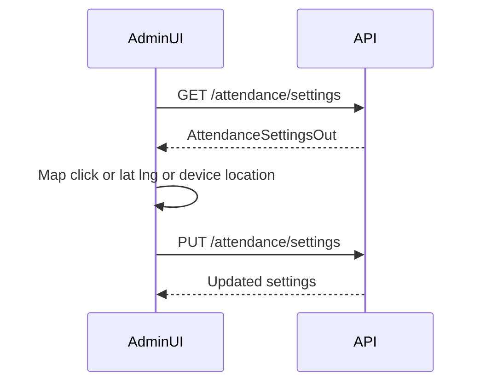
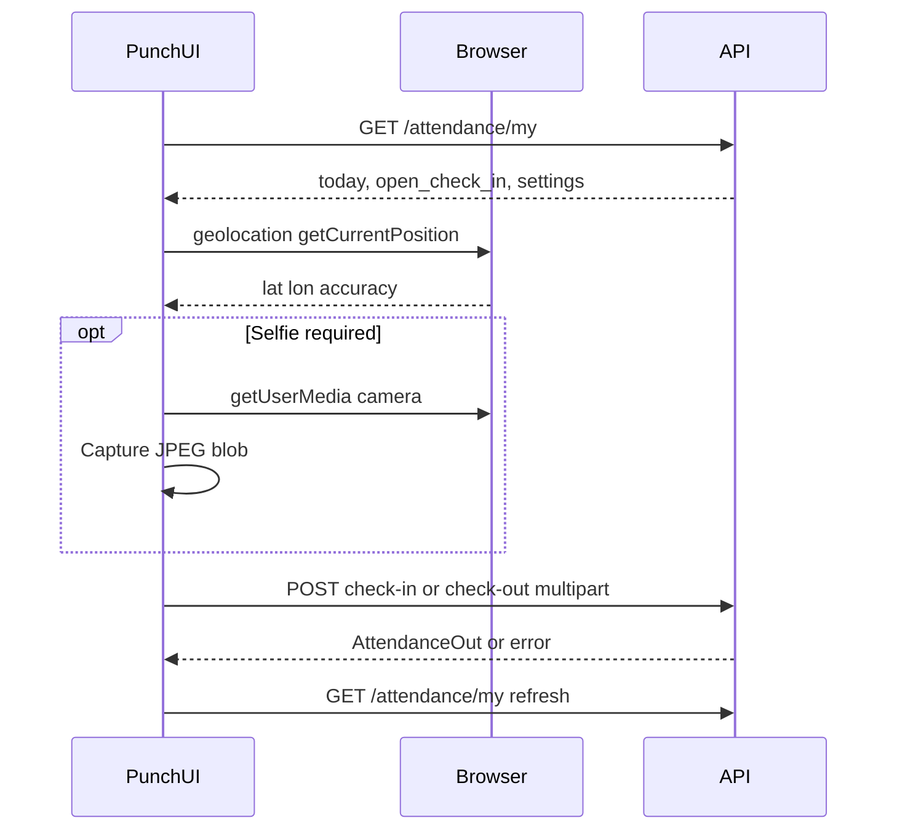

# Frontend — HRMS Attendance (calendar, punch, settings)

**Backend:** [Attendance](attendance.md)  
**Base:** `/api/v1/hrms/attendance`  
**Shell:** [HRMS frontend](frontend.md) · [Architecture frontend](../architecture/frontend.md)

**Style:** Framework-agnostic. No React/Vue/Angular code. Describes screens, flows, API contracts, permission gating, and edge cases.

## Purpose

Three product surfaces:

1. **Month status calendar** — view / mark / correct daily attendance.
2. **Employee punch** — browser geolocation (+ optional selfie) for check-in / check-out inside a configured office geofence.
3. **Attendance settings** — admin configures office pin, radius, GPS accuracy policy, selfie rules, and full/half-day minute thresholds.

Punch is the primary path for on-site days when location attendance is enabled. HR mark / correction remains the **exception path** (WFH, ON_DUTY, false geofence rejects, disputes).

## Prerequisites (read first)

| Topic | Where |
|---|---|
| Auth, Bearer token, permission store | [Architecture frontend](../architecture/frontend.md) |
| HRMS nav, scope SELF/TEAM/ALL, `current_employee` | [HRMS frontend](frontend.md) |
| Backend rules (Haversine, status derivation, locking) | [Attendance](attendance.md) |
| Unified month overlay | [Calendar frontend](frontend-calendar.md) |

**Identity:** Punch always applies to the signed-in user’s linked `employees` row. Users without an employee profile cannot punch — show “No employee profile linked”.

**Realtime:** None. Poll / refresh after punch, mark, or correction. No WebSocket events for attendance.

---

## Screens and navigation

| Screen | Logical route | Gate | Typical persona |
|---|---|---|---|
| Month calendar | `/hrms/attendance` | `attendance.view` | All with view |
| Punch in/out | `/hrms/attendance/punch` | `attendance.punch` | Employee, Manager (self) |
| Attendance settings | `/hrms/attendance/settings` | `attendance.settings.manage` | HR_ADMIN, Admin |
| Mark day | modal / action on calendar cell | `attendance.mark` | HR |
| Instant correction | modal on locked / existing row | `attendance.correct` (ALL scope) | HR |
| Correction petition | optional flow on row | `attendance_correction.create` | Employee / Manager |

Suggested HRMS nav extras (show only if `can`):

- **Punch** → `/hrms/attendance/punch` when `attendance.punch`
- **Att. settings** → `/hrms/attendance/settings` when `attendance.settings.manage`

From the calendar header, deep-link to Punch and Settings the same way.

Related read-only overlay: [Unified calendar](frontend-calendar.md) (`GET /hrms/calendar`) — same ABSENT synthesis when location attendance is on.

---

## Domain model for UI

### Statuses

```text
PRESENT | ABSENT | HALF_DAY | LEAVE | WFH | HOLIDAY | WEEK_OFF | ON_DUTY | UNMARKED
```

| Status | How it usually appears |
|---|---|
| `PRESENT` | Punch-out met full-day minutes, or HR marked |
| `HALF_DAY` | Punch-out met half-day but not full, or HR marked |
| `ABSENT` | Default for working days when geo attendance is on and hours not met; also after check-in before qualifying checkout |
| `LEAVE` / `HOLIDAY` / `WEEK_OFF` | Protected — do not overwrite via punch or silent mark |
| `WFH` / `ON_DUTY` | HR mark exception |
| `UNMARKED` | Only when location attendance is **off** and no row yet |

### Sources

```text
ADMIN | LEAVE | HOLIDAY | WEEK_OFF | SYSTEM | PUNCH
```

Show source on detail/tooltips when useful (“PUNCH”, “LEAVE”, “ADMIN”).

### Calendar cell synthesis (display rules)

For each day in the month response:

1. Row exists → use `status` / `source`; show `check_in_at`, `check_out_at`, `worked_minutes`, `attendance_id` when present.
2. Else holiday → `HOLIDAY`.
3. Else week off → `WEEK_OFF`.
4. Else if location attendance enabled **and** working day **and** date ≤ today (office timezone) → **`ABSENT`**.
5. Else → **`UNMARKED`**.

Do **not** invent PRESENT on the client. Trust the calendar API.

### Status after punch (product copy)

| Event | Expected status |
|---|---|
| Successful check-in | `ABSENT` (open day; hours not complete yet) |
| Check-out, minutes ≥ full day | `PRESENT` |
| Check-out, half ≤ minutes &lt; full | `HALF_DAY` |
| Check-out, minutes &lt; half | `ABSENT` |
| Check-in only (no checkout) | Stays `ABSENT` |

Defaults (configurable in settings): full day **480** minutes, half day **240** minutes.

---

## Permission gating

| Code | Scope-aware? | UI behavior |
|---|---|---|
| `attendance.view` | Yes | Calendar, `GET /settings` (read), `GET /my`, selfie download |
| `attendance.punch` | Yes (typically SELF) | Punch screen; never punch for another employee |
| `attendance.settings.manage` | **No** | Settings screen; hide from role UI scope pickers |
| `attendance.mark` | Yes (usually ALL) | Mark / bulk-mark actions |
| `attendance.correct` | Yes (instant needs **ALL**) | Instant correction modal |
| `attendance_correction.view` | Yes | Correction request list (if built) |
| `attendance_correction.create` | Yes | Submit petition |
| `attendance_correction.approve` / `reject` / `cancel` | Yes | Workflow actions |

### Scope UX on calendar

| Scope | Behavior |
|---|---|
| `SELF` | Hide employee ID picker; load calendar for self only |
| `TEAM` | Optional employee filter limited to team |
| `ALL` | Employee ID / search filter |
| Missing permission | Route guard → forbidden; do not render empty fake calendar |

### Role-flavored emphasis

| Persona | Emphasize |
|---|---|
| EMPLOYEE | Punch + own calendar |
| MANAGER | Own punch + team calendar view; correction approve/reject if granted |
| HR_ADMIN / Admin | Settings + mark/correct + org calendar |

After granting new permissions in Admin, client must **refresh permission list** (re-login or reload `/permissions`) so Punch / Settings nav appears.

---

## Primary flows

### A. Admin configures office (settings)



**Screen fields**

| Field | Notes |
|---|---|
| Office name | Display string for punch page |
| Latitude / Longitude | Manual entry; keep in sync with map pin |
| Map | Leaflet + OpenStreetMap tiles; click to set pin; optional “Use my location” |
| Allowed radius | Presets **25 / 100 / 250 / 500** m (and free numeric within API bounds) |
| Max GPS accuracy (m) | Reject punches reporting worse accuracy |
| Geofence accuracy mode | `CONSERVATIVE` (default) or `DISTANCE_ONLY` |
| Require selfie | Each punch needs a photo when true |
| Require geofence on punch-out | Same location policy on checkout when true |
| Enable location attendance | Master switch; requires coords before enable |
| Full / half day minutes | half must be **&lt;** full |
| Timezone | e.g. `Asia/Kolkata` — defines “today” for punches |

**Help text (required):**

- Conservative mode: accept only if `distance + reported_accuracy ≤ radius` (plus max-accuracy gate). Can reject legitimate punches near the edge — employee should retry; HR can mark/correct.
- GPS is not tamper-proof; do not claim “proof of presence”.

**Map UX**

- Sync: changing lat/lng updates pin; clicking map updates lat/lng.
- Draw radius circle around pin when coords exist.
- Do not call paid Google Maps APIs for v1.

**Save:** `PUT /attendance/settings` with partial or full body. On success, toast and keep form in sync with response.

**Validation (client, mirror server):**

- Lat ∈ [-90, 90], lon ∈ [-180, 180]
- Cannot enable location attendance without both coordinates
- Half-day minutes &lt; full-day minutes

---

### B. Employee punch in / out



**Load**

1. `GET /attendance/my` → `today`, `open_check_in`, `location_attendance_enabled`, `settings`, `recent`.
2. If `location_attendance_enabled` is false → empty state: “Location-based attendance is not enabled. Ask HR to configure the office geofence.” Hide punch buttons.
3. Request geolocation with `enableHighAccuracy: true`, sensible timeout (~15–20s), `maximumAge: 0`.

**Display**

- Office name, radius, accuracy mode.
- Live coords + reported accuracy.
- Client **hint** distance to office (Haversine on client is OK for UX only — **server enforces**).
- Under `CONSERVATIVE`, optionally show effective distance `distance + accuracy` vs radius.
- Today’s status, check-in/out times, worked minutes when present.

**Selfie (when `settings.require_selfie`)**

1. Open camera (`getUserMedia`, preferably user-facing).
2. Capture frame → JPEG (or PNG) blob; show preview.
3. Append as multipart field `selfie` on submit.
4. Block submit if selfie missing when required.
5. Stop media tracks on leave page.

**Actions**

| Button | Enabled when | Call |
|---|---|---|
| Punch in | Has coords; not `open_check_in`; not already checked out for day | `POST /attendance/check-in` |
| Punch out | Has coords; `open_check_in` true | `POST /attendance/check-out` |
| Refresh location | Always when enabled | Re-run geolocation |

**Multipart body (both punch endpoints)**

| Field | Type | Required |
|---|---|---|
| `latitude` | form number | yes |
| `longitude` | form number | yes |
| `accuracy_meters` | form number | yes (from `coords.accuracy`) |
| `selfie` | file | when settings require selfie |

Do **not** set `Content-Type: application/json`. Let the client set multipart boundary automatically.

**Double-submit**

- Disable Punch In/Out while request in flight.
- Backend row lock + unique day constraint is authoritative; treat `409` as “already punched” even if UI glitched.

**After success**

- Toast check-in or check-out.
- Refresh `GET /attendance/my` and optionally calendar for current month.
- Clear selfie preview for next punch.

---

### C. Month calendar — view / mark / correct

**Load:** `GET /attendance/calendar?year=&month=&employee_id=` (omit `employee_id` for SELF / default scoped set). Use shared `hrms_year` / `hrms_month` from HRMS shell.

**Cell content**

- Day number, status label, optional holiday name.
- If punched: short check-in / check-out time and `worked_minutes`.

**Cell colors (suggested)**

| Status | Treatment |
|---|---|
| WEEK_OFF | Muted |
| HOLIDAY | Accent blue |
| PRESENT | Green |
| ABSENT | Red / warning |
| LEAVE | Yellow / amber |
| HALF_DAY / WFH / ON_DUTY / UNMARKED | Distinct neutrals |

**Interact**

| Capability | Behavior |
|---|---|
| `attendance.mark` | Open mark modal on working days that are unmarked or ADMIN-editable |
| `attendance.correct` | Correction on protected or existing rows; reason required |
| Neither | Cells read-only |

**Mark:** `POST /attendance/mark` with `{ employee_id, attendance_date, status, reason?, remarks? }` — statuses typically `PRESENT`, `ABSENT`, `HALF_DAY`, `WFH`, `ON_DUTY`.

**Bulk mark (optional screen):** `POST /attendance/bulk-mark` with `{ items: [ ... ] }`.

**Instant correction:** `POST /attendance/{attendance_id}/correction` with `{ status, reason, remarks? }` — needs `attendance.correct` + ALL scope; on 403, suggest petition flow.

**Petition (optional):** `POST /attendance/{id}/corrections` → list/approve/reject/cancel under `attendance_correction.*`. Row unchanged until final approve.

Do not use mark/punch to overwrite `LEAVE` / `HOLIDAY` / `WEEK_OFF` — show “use correction”.

---

## API mapping

All paths under `/api/v1/hrms`. Attach `Authorization: Bearer <access_token>`.

### Settings

| Method | Path | Permission | Body / query |
|---|---|---|---|
| GET | `/attendance/settings` | `attendance.view` | — |
| PUT | `/attendance/settings` | `attendance.settings.manage` | See settings fields above (partial OK) |

**`AttendanceSettingsOut` (highlights):**  
`office_name`, `office_latitude`, `office_longitude`, `allowed_radius_meters`, `max_gps_accuracy_meters`, `geofence_accuracy_mode`, `require_selfie`, `require_geofence_on_checkout`, `location_attendance_enabled`, `required_full_day_minutes`, `required_half_day_minutes`, `timezone`, timestamps.

### Punch / my day

| Method | Path | Permission | Body |
|---|---|---|---|
| GET | `/attendance/my` | `attendance.view` | — |
| POST | `/attendance/check-in` | `attendance.punch` | multipart |
| POST | `/attendance/check-out` | `attendance.punch` | multipart |
| GET | `/attendance/selfies/{attendance_id}/{kind}` | `attendance.view` | `kind` = `check_in` \| `check_out` |

**`MyAttendanceOut`:**  
`today` (AttendanceOut or null), `open_check_in` (bool), `location_attendance_enabled`, `settings`, `recent[]`.

**`AttendanceOut` punch fields:**  
`check_in_at`, `check_in_latitude`, `check_in_longitude`, `check_in_accuracy_meters`, `check_in_distance_meters`, `check_in_selfie_storage_key`, parallel `check_out_*`, `worked_minutes`, plus `status`, `source`, `attendance_date`, etc.

Selfie download returns binary image (`image/jpeg` or `image/png`) with auth — use blob URL for preview; never a public CDN path.

### Calendar / list / mark

| Method | Path | Permission | Notes |
|---|---|---|---|
| GET | `/attendance/calendar` | view | `year`, `month`, optional `employee_id` → list of `{ employee_id, days[] }` |
| GET | `/attendance/` | view | Paginated list; filters `employee_id`, `start_date`, `end_date`, `limit`, `offset` |
| GET | `/attendance/summary` | view | KPIs `total`, `status` map |
| POST | `/attendance/mark` | mark | Single day |
| POST | `/attendance/bulk-mark` | mark | `{ items: [...] }` |
| POST | `/attendance/{id}/correction` | correct | Instant HR |
| GET/POST | `/attendance/corrections` … | correction.* | Petition workflow |

**Calendar day cell extras:** `check_in_at`, `check_out_at`, `worked_minutes`, `attendance_id`, `holiday_name`, `week_off`.

---

## Geofence UX (client messaging)

Server always decides accept/reject. Client should mirror messages clearly.

| Situation | User-facing guidance |
|---|---|
| Location permission denied | Explain how to enable site location; do **not** invent coordinates |
| Accuracy too poor | “GPS accuracy is too poor. Move outdoors or wait for a better fix, then retry.” |
| Outside geofence (conservative or distance-only) | Show distance vs radius; “Move closer and retry.” Mention HR correction if stuck near boundary |
| Already checked in / out (`409`) | “Already punched for today.” Refresh `/my` |
| Non-working day | “Cannot punch on week off or holiday.” |
| Protected leave/holiday row | “This day is protected; ask HR to correct.” |
| Location attendance off | Point user to HR settings |
| No employee profile | “No employee profile linked.” |

**Conservative example (document in settings help):**  
Radius 100 m, reported distance 95 m, accuracy 30 m → rejected (95+30=125 &gt; 100). Same punch may pass under `DISTANCE_ONLY`.

Client distance is a **hint only**. Never skip the API call because the client thinks the user is inside.

---

## Error handling matrix

| HTTP | Typical cause | UI |
|---|---|---|
| 400 | Validation, disabled feature, missing selfie, poor accuracy, outside fence, non-working day | Inline / toast with server `detail` |
| 401 | Token expired | Refresh token flow (shell) |
| 403 | Missing permission or out of scope | Forbidden / hide control |
| 404 | Attendance / selfie missing | Soft empty |
| 409 | Duplicate punch / protected source | Non-retry toast; refresh state |
| 413 | Selfie too large | Ask to recapture (keep under ~5 MiB) |

Prefer displaying the API `detail` string when present — it already includes retry / HR guidance for geofence cases.

---

## Shared client state (suggested)

| Key | Source | Used by |
|---|---|---|
| `hrms_year` / `hrms_month` | Shell | Calendar |
| `attendanceSettings` | GET settings or nested in `/my` | Punch + Settings |
| `myAttendance` | GET `/my` | Punch |
| `attendanceCalendar` | GET calendar | Calendar screen |
| `current_employee` | `/employees/me/profile` | SELF binding |

---

## Accessibility and device notes

- Punch requires **HTTPS** (or localhost) for geolocation and camera in modern browsers.
- Prefer mobile-friendly punch layout; large Punch In / Out targets.
- Camera: handle permission denial separately from location denial.
- Map: ensure keyboard/alternative lat-lng inputs always work without relying on map click alone.
- Do not auto-submit punches; user must confirm action.

---

## Edge cases and non-goals

**Handle**

- Concurrent double-tap → disable buttons; honor 409.
- Open check-in across midnight: “today” is office `timezone` from settings — after midnight local office date, treat as new day (no checkout for previous day via punch UI; HR corrects if needed).
- Leave-approved days: punch must fail; calendar shows LEAVE.
- Settings changed mid-day (radius/mode): next punch uses new rules; already-saved punches keep stored distance/accuracy audit fields.

**Non-goals (v1 UI)**

- Face recognition / liveness / matching selfie to employee photo.
- Multi-office map (single org pin only).
- Night-shift spanning two calendar dates.
- Spoofing detection beyond showing that GPS is not tamper-proof.
- Paid map providers.

---

## Implementation checklist

- [ ] Nav + routes for calendar, punch, settings with correct permission gates
- [ ] Settings: map ↔ lat/lng sync, radius presets, mode help text, enable guard
- [ ] Punch: geolocation, optional camera, multipart submit, double-submit lock
- [ ] `/my` drives open check-in and button enablement
- [ ] Calendar shows ABSENT synthesis + punch times; mark/correct exception path
- [ ] Clear error copy for permission / accuracy / geofence / 409
- [ ] Refresh permissions after RBAC grant so new codes appear
- [ ] No client-only geofence accept; no fabricated coordinates

## Related guides

| Guide | File |
|---|---|
| Backend attendance | [attendance.md](attendance.md) |
| HRMS shell | [frontend.md](frontend.md) |
| Unified calendar | [frontend-calendar.md](frontend-calendar.md) |
| Leave (attendance LEAVE upsert) | [frontend-leave.md](frontend-leave.md) |
| App shell / auth | [../architecture/frontend.md](../architecture/frontend.md) |
